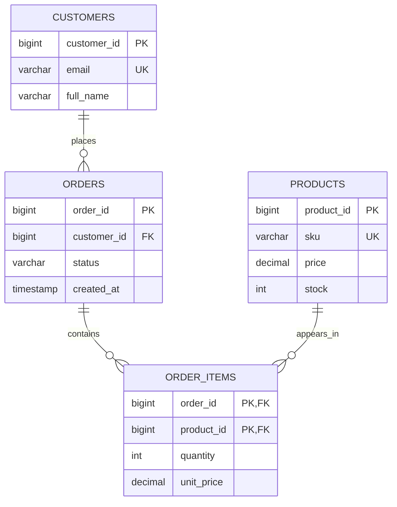

# MySQL Table Creation & Constraints — Beginner to Advanced

> A practical, interview-focused guide to designing reliable MySQL tables, enforcing data integrity, and understanding the trade-offs behind schema decisions.

   

## Table of Contents

1. [Getting Started](#1-getting-started)
2. [CREATE TABLE Fundamentals](#2-create-table-fundamentals)
3. [Data Types](#3-data-types)
4. [Constraint Overview](#4-constraint-overview)
5. [NOT NULL](#5-not-null)
6. [UNIQUE](#6-unique)
7. [PRIMARY KEY](#7-primary-key)
8. [AUTO_INCREMENT](#8-auto_increment)
9. [DEFAULT and Timestamps](#9-default-and-timestamps)
10. [CHECK](#10-check)
11. [FOREIGN KEY and Referential Actions](#11-foreign-key-and-referential-actions)
12. [Complete Employee Schema](#12-complete-employee-schema)
13. [ALTER TABLE](#13-alter-table)
14. [CREATE TABLE Variants](#14-create-table-variants)
15. [Indexes and Complexity](#15-indexes-and-complexity)
16. [Advanced Table Features](#16-advanced-table-features)
17. [Real-World E-Commerce Project](#17-real-world-e-commerce-project)
18. [Common Errors and Debugging](#18-common-errors-and-debugging)
19. [Interview Questions](#19-interview-questions)
20. [Exercises](#20-exercises)
21. [Best Practices and Cheat Sheet](#21-best-practices-and-cheat-sheet)

---

## 1. Getting Started

**Prerequisites:** MySQL Server 8.0.16+ (8.4 LTS recommended), MySQL Workbench or a SQL client, and basic familiarity with rows and columns.

> **Version note:** MySQL versions before 8.0.16 parsed but did **not enforce** `CHECK` constraints. This guide assumes a modern MySQL version using the InnoDB storage engine. Some behavior depends on SQL mode and MySQL version.

Create a sandbox database:

```sql
CREATE DATABASE IF NOT EXISTS mysql_constraints_lab;
USE mysql_constraints_lab;

SELECT VERSION();
SELECT @@sql_mode;
```

Run each numbered section independently. Some sections intentionally create tables with the same logical purpose; they use distinct table names so you can practice safely.

Useful inspection commands:

```sql
SHOW TABLES;
DESCRIBE some_table;
SHOW CREATE TABLE some_table;
SHOW INDEX FROM some_table;
```

Replace `some_table` with a table you have created.

## 2. CREATE TABLE Fundamentals

`CREATE TABLE` is a **DDL (Data Definition Language)** statement. It defines columns, data types, constraints, indexes, and table options.

```sql
CREATE TABLE table_name (
    column_name data_type [column_attributes],
    another_column data_type [column_attributes],
    [table_constraints_and_indexes]
) ENGINE = InnoDB;
```

Example:

```sql
CREATE TABLE basic_employees (
    employee_id INT,
    full_name VARCHAR(100),
    age INT,
    salary DECIMAL(10, 2),
    joined_on DATE
) ENGINE = InnoDB;

INSERT INTO basic_employees
    (employee_id, full_name, age, salary, joined_on)
VALUES
    (101, 'Rahul', 24, 50000.00, '2026-01-15'),
    (102, 'Priya', 26, 65000.00, '2026-02-10');

SELECT * FROM basic_employees;
```

Expected output:

| employee_id | full_name | age | salary | joined_on |
|---:|---|---:|---:|---|
| 101 | Rahul | 24 | 50000.00 | 2026-01-15 |
| 102 | Priya | 26 | 65000.00 | 2026-02-10 |

**Column-level** constraints are written beside a column; **table-level** constraints follow the column definitions. Composite constraints generally use table-level syntax.

## 3. Data Types

| Category | Common types | Typical use |
|---|---|---|
| Integer | `TINYINT`, `SMALLINT`, `INT`, `BIGINT` | IDs, counts, quantities |
| Exact numeric | `DECIMAL(p,s)` | Money and precise decimal values |
| Approximate numeric | `FLOAT`, `DOUBLE` | Scientific/approximate measurements |
| Strings | `CHAR(n)`, `VARCHAR(n)`, `TEXT` | Codes, names, descriptions |
| Date/time | `DATE`, `TIME`, `DATETIME`, `TIMESTAMP` | Dates and event timestamps |
| Boolean-like | `BOOLEAN` / `BOOL` | Alias for `TINYINT(1)` in MySQL |
| Structured | `JSON` | Validated JSON documents |
| Binary | `BINARY`, `VARBINARY`, `BLOB` | Raw binary content |

```sql
CREATE TABLE data_type_demo (
    id BIGINT UNSIGNED PRIMARY KEY,
    code CHAR(6) NOT NULL,
    name VARCHAR(120) NOT NULL,
    price DECIMAL(12, 2) NOT NULL,
    active BOOLEAN NOT NULL DEFAULT TRUE,
    launched_on DATE,
    metadata JSON,
    created_at TIMESTAMP DEFAULT CURRENT_TIMESTAMP
);
```

**Design tips:** Prefer `DECIMAL` to `FLOAT` for money. `VARCHAR(100)` means up to 100 characters (storage depends on character set). `TIMESTAMP` is time-zone converted by MySQL; `DATETIME` is not. MySQL `BOOLEAN` does not automatically restrict values to 0 and 1: use `CHECK (active IN (0,1))` when that matters.

## 4. Constraint Overview

| Feature | Meaning | Example |
|---|---|---|
| `NOT NULL` | Value must be present | `name VARCHAR(100) NOT NULL` |
| `UNIQUE` | No duplicate non-NULL keys | `UNIQUE (email)` |
| `PRIMARY KEY` | Unique, non-NULL row identifier | `PRIMARY KEY (id)` |
| `FOREIGN KEY` | Enforces a parent/child relationship | `FOREIGN KEY (dept_id) REFERENCES departments(id)` |
| `CHECK` | Enforces a condition | `CHECK (price > 0)` |
| `DEFAULT` | Supplies an omitted value | `status VARCHAR(20) DEFAULT 'ACTIVE'` |
| `AUTO_INCREMENT` | Generates numeric IDs | `id INT AUTO_INCREMENT` |

**Terminology:** `DEFAULT` and `AUTO_INCREMENT` are technically column attributes rather than relational integrity constraints, but are commonly studied alongside them.

## 5. NOT NULL

```sql
CREATE TABLE nn_students (
    student_id INT NOT NULL,
    full_name VARCHAR(100) NOT NULL,
    email VARCHAR(150),
    age INT
);

INSERT INTO nn_students VALUES
    (1, 'Rahul', 'rahul@example.com', 22);
```

This is **invalid**; run only to observe the error:

```sql
-- INSERT INTO nn_students (student_id, full_name)
-- VALUES (2, NULL);
```

`NULL` means **missing/unknown**, not `0` or `''`.

```sql
SELECT * FROM nn_students WHERE email IS NULL;
SELECT * FROM nn_students WHERE email IS NOT NULL;
```

Do not use `email = NULL`: SQL comparisons with `NULL` evaluate to unknown.

## 6. UNIQUE

```sql
CREATE TABLE unique_users (
    user_id INT PRIMARY KEY,
    email VARCHAR(150) UNIQUE,
    phone VARCHAR(20) UNIQUE
);

INSERT INTO unique_users VALUES
    (1, 'a@example.com', '9000000001'),
    (2, 'b@example.com', '9000000002'),
    (3, NULL, NULL),
    (4, NULL, NULL);
```

In MySQL, a nullable unique index generally allows **multiple `NULL` values**. Duplicate non-NULL email or phone values fail.

**Composite UNIQUE:**

```sql
CREATE TABLE course_enrollments (
    student_id INT NOT NULL,
    course_id INT NOT NULL,
    enrolled_on DATE,
    CONSTRAINT uq_student_course UNIQUE (student_id, course_id)
);

INSERT INTO course_enrollments VALUES
    (101, 1, '2026-01-10'),
    (101, 2, '2026-01-11'),
    (102, 1, '2026-01-12');

-- Duplicate pair: rejected
-- INSERT INTO course_enrollments VALUES (101, 1, '2026-01-13');
```

`UNIQUE (student_id, course_id)` checks the **pair**, not either column alone. If nullable columns participate in a composite unique key, MySQL's `NULL` behavior still matters.

## 7. PRIMARY KEY

```sql
CREATE TABLE pk_employees (
    employee_id INT PRIMARY KEY,
    full_name VARCHAR(100) NOT NULL
);
```

Equivalent table-level syntax:

```sql
CREATE TABLE pk_employees_alt (
    employee_id INT,
    full_name VARCHAR(100) NOT NULL,
    CONSTRAINT pk_employees_alt_id PRIMARY KEY (employee_id)
);
```

Composite primary key:

```sql
CREATE TABLE pk_order_items (
    order_id INT NOT NULL,
    product_id INT NOT NULL,
    quantity INT NOT NULL,
    PRIMARY KEY (order_id, product_id)
);
```

| Property | `PRIMARY KEY` | `UNIQUE` |
|---|---|---|
| Duplicate keys | No | No (for non-NULL keys) |
| NULL allowed | No | Yes unless separately prohibited |
| Per table | One | Many |
| Multi-column | Yes | Yes |
| Index created | Yes | Yes |

**InnoDB internals:** The primary key normally defines the **clustered index**: row data is organized by its primary-key B-tree. InnoDB secondary-index entries also carry the primary-key value. Very wide primary keys therefore increase secondary-index storage costs.

## 8. AUTO_INCREMENT

```sql
CREATE TABLE ai_customers (
    customer_id BIGINT UNSIGNED AUTO_INCREMENT PRIMARY KEY,
    full_name VARCHAR(100) NOT NULL
) AUTO_INCREMENT = 1000;

INSERT INTO ai_customers (full_name)
VALUES ('Rahul'), ('Priya'), ('Aman');

SELECT * FROM ai_customers;
SELECT LAST_INSERT_ID();
```

To adjust the next counter:

```sql
ALTER TABLE ai_customers AUTO_INCREMENT = 5000;
```

**Important:** One `AUTO_INCREMENT` column per table; it must be indexed, and it is not guaranteed to produce gap-free sequences. Deletions, failed statements, concurrent inserts, and rollbacks may leave gaps. `LAST_INSERT_ID()` is connection-specific.

## 9. DEFAULT and Timestamps

```sql
CREATE TABLE default_employees (
    employee_id INT PRIMARY KEY,
    full_name VARCHAR(100) NOT NULL,
    salary DECIMAL(10,2) NOT NULL DEFAULT 30000.00,
    status VARCHAR(20) NOT NULL DEFAULT 'ACTIVE'
);

INSERT INTO default_employees (employee_id, full_name)
VALUES (1, 'Rahul');

SELECT * FROM default_employees;
```

| employee_id | full_name | salary | status |
|---:|---|---:|---|
| 1 | Rahul | 30000.00 | ACTIVE |

Automatic timestamps:

```sql
CREATE TABLE tracked_documents (
    document_id BIGINT AUTO_INCREMENT PRIMARY KEY,
    title VARCHAR(200) NOT NULL,
    created_at TIMESTAMP NOT NULL DEFAULT CURRENT_TIMESTAMP,
    updated_at TIMESTAMP NOT NULL DEFAULT CURRENT_TIMESTAMP
        ON UPDATE CURRENT_TIMESTAMP
);

INSERT INTO tracked_documents (title) VALUES ('Schema notes');
UPDATE tracked_documents SET title = 'Updated schema notes' WHERE document_id = 1;
```

Defaults generally apply when a column is **omitted** or `DEFAULT` is specified; explicitly providing `NULL` to a nullable column does not normally trigger its default. `ON UPDATE CURRENT_TIMESTAMP` automatically updates the column when another column's value changes (subject to explicit timestamp assignments).

## 10. CHECK

```sql
CREATE TABLE checked_products (
    product_id INT PRIMARY KEY,
    name VARCHAR(100) NOT NULL,
    price DECIMAL(10,2) NOT NULL,
    discount DECIMAL(10,2) NOT NULL DEFAULT 0,
    CONSTRAINT chk_positive_price CHECK (price > 0),
    CONSTRAINT chk_valid_discount CHECK (discount >= 0 AND discount <= price)
);

INSERT INTO checked_products VALUES (1, 'Keyboard', 1499.00, 200.00);
-- Invalid:
-- INSERT INTO checked_products VALUES (2, 'Mouse', -10.00, 0.00);
```

A `CHECK` accepts expressions evaluating to `TRUE` **or `UNKNOWN`**, but rejects `FALSE`:

```sql
CREATE TABLE checked_people (
    id INT PRIMARY KEY,
    age INT CHECK (age >= 18)
);

INSERT INTO checked_people VALUES (1, NULL); -- Accepted
```

To forbid `NULL` as well:

```sql
CREATE TABLE checked_adults (
    id INT PRIMARY KEY,
    age INT NOT NULL CHECK (age >= 18)
);
```

`CHECK` cannot generally enforce relationships across rows or reference another table; use `UNIQUE`, `FOREIGN KEY`, or application/transaction logic as appropriate.

## 11. FOREIGN KEY and Referential Actions

A foreign key links a child table to a parent table and protects referential integrity.

```text
departments (parent)          fk_employees (child)
+------------------+         +----------------------+
| dept_id (PK)     |<--------| dept_id (FK)         |
| dept_name        |  1 : N  | employee_id (PK)     |
+------------------+         | full_name            |
                             +----------------------+
```

```sql
CREATE TABLE fk_departments (
    dept_id INT PRIMARY KEY,
    dept_name VARCHAR(100) NOT NULL
) ENGINE = InnoDB;

CREATE TABLE fk_employees (
    employee_id INT PRIMARY KEY,
    full_name VARCHAR(100) NOT NULL,
    dept_id INT,
    CONSTRAINT fk_employee_department
        FOREIGN KEY (dept_id)
        REFERENCES fk_departments(dept_id)
) ENGINE = InnoDB;

INSERT INTO fk_departments VALUES (1, 'Engineering'), (2, 'HR');
INSERT INTO fk_employees VALUES (101, 'Rahul', 1), (102, 'Priya', 2);

-- Rejected: no matching department 99
-- INSERT INTO fk_employees VALUES (103, 'Aman', 99);
```

### Referential actions

| Action | `ON DELETE` / `ON UPDATE` behavior |
|---|---|
| `CASCADE` | Delete child rows / propagate parent-key changes |
| `SET NULL` | Set child FK column(s) to NULL; requires nullable columns |
| `RESTRICT` | Reject parent changes while referenced |
| `NO ACTION` | InnoDB treats it like `RESTRICT` (no deferred checking) |
| `SET DEFAULT` | Not supported by InnoDB as an FK action |

**CASCADE example:**

```sql
CREATE TABLE cascade_departments (
    dept_id INT PRIMARY KEY,
    dept_name VARCHAR(100) NOT NULL
);

CREATE TABLE cascade_employees (
    employee_id INT PRIMARY KEY,
    dept_id INT NOT NULL,
    FOREIGN KEY (dept_id) REFERENCES cascade_departments(dept_id)
        ON DELETE CASCADE ON UPDATE CASCADE
);

INSERT INTO cascade_departments VALUES (1, 'Engineering');
INSERT INTO cascade_employees VALUES (101, 1), (102, 1);
DELETE FROM cascade_departments WHERE dept_id = 1;
-- Both matching child rows are also deleted.
```

**SET NULL example:**

```sql
CREATE TABLE nullable_departments (
    dept_id INT PRIMARY KEY
);

CREATE TABLE nullable_employees (
    employee_id INT PRIMARY KEY,
    dept_id INT NULL,
    FOREIGN KEY (dept_id) REFERENCES nullable_departments(dept_id)
        ON DELETE SET NULL
);
```

**FK design requirements:** Use compatible column types (including integer width and signedness), a supported storage engine such as InnoDB, and suitable indexes. Referenced keys should be unique/primary keys for portable, reliable design; relying on InnoDB's historical support for non-unique referenced indexes is discouraged and version-dependent. The parent table should be created first.

## 12. Complete Employee Schema

A practical example combining the main constraints:

```sql
CREATE TABLE company_departments (
    dept_id INT AUTO_INCREMENT PRIMARY KEY,
    dept_name VARCHAR(100) NOT NULL UNIQUE
) ENGINE = InnoDB;

CREATE TABLE company_employees (
    employee_id BIGINT AUTO_INCREMENT PRIMARY KEY,
    employee_code VARCHAR(20) NOT NULL UNIQUE,
    full_name VARCHAR(100) NOT NULL,
    email VARCHAR(150) NOT NULL UNIQUE,
    age INT NOT NULL,
    salary DECIMAL(12,2) NOT NULL DEFAULT 30000.00,
    status VARCHAR(20) NOT NULL DEFAULT 'ACTIVE',
    dept_id INT NULL,
    created_at TIMESTAMP NOT NULL DEFAULT CURRENT_TIMESTAMP,
    updated_at TIMESTAMP NOT NULL DEFAULT CURRENT_TIMESTAMP
        ON UPDATE CURRENT_TIMESTAMP,

    CONSTRAINT chk_company_age CHECK (age >= 18),
    CONSTRAINT chk_company_salary CHECK (salary >= 0),
    CONSTRAINT chk_company_status CHECK (status IN ('ACTIVE', 'INACTIVE', 'ON_LEAVE')),
    CONSTRAINT fk_company_department FOREIGN KEY (dept_id)
        REFERENCES company_departments(dept_id)
        ON DELETE SET NULL ON UPDATE CASCADE
) ENGINE = InnoDB;

INSERT INTO company_departments (dept_name)
VALUES ('Engineering'), ('Finance');

INSERT INTO company_employees
    (employee_code, full_name, email, age, salary, dept_id)
VALUES
    ('EMP001', 'Rahul Kumar', 'rahul@company.com', 24, 65000, 1),
    ('EMP002', 'Priya Sharma', 'priya@company.com', 26, 72000, 2);

SELECT e.employee_id, e.full_name, e.salary, d.dept_name
FROM company_employees AS e
LEFT JOIN company_departments AS d ON e.dept_id = d.dept_id;
```

## 13. ALTER TABLE

Modify an existing schema without rebuilding it manually.

```sql
-- Add a column
ALTER TABLE company_employees ADD COLUMN phone VARCHAR(20) NULL;

-- Rename a column
ALTER TABLE company_employees RENAME COLUMN phone TO mobile_number;

-- Change its type/attributes (ensure existing data is compatible)
ALTER TABLE company_employees MODIFY COLUMN mobile_number VARCHAR(25) NULL;

-- Add a new check
ALTER TABLE company_employees
ADD CONSTRAINT chk_company_salary_cap CHECK (salary <= 10000000);

-- Remove that check
ALTER TABLE company_employees DROP CHECK chk_company_salary_cap;

-- Remove the temporary column
ALTER TABLE company_employees DROP COLUMN mobile_number;
```

Add/drop a named unique index on a **new** column:

```sql
ALTER TABLE company_employees ADD COLUMN badge_number VARCHAR(30);
ALTER TABLE company_employees ADD CONSTRAINT uq_badge_number UNIQUE (badge_number);
ALTER TABLE company_employees DROP INDEX uq_badge_number;
```

Drop an FK:

```sql
ALTER TABLE company_employees DROP FOREIGN KEY fk_company_department;
```

Inspect actual names before dropping constraints:

```sql
SHOW CREATE TABLE company_employees;
SHOW INDEX FROM company_employees;
```

> **Production caution:** `ALTER TABLE` may lock, rebuild, or copy a large table depending on the operation and MySQL version. Test migration plans, consider online DDL support, and avoid blindly applying schema changes during peak traffic. Adding a constraint can fail if existing rows violate it.

## 14. CREATE TABLE Variants

### IF NOT EXISTS

```sql
CREATE TABLE IF NOT EXISTS demo_contacts (
    id INT PRIMARY KEY,
    name VARCHAR(100)
);
```

Does **not** verify or migrate the schema if the table already exists.

### LIKE

```sql
CREATE TABLE company_employees_backup LIKE company_employees;
INSERT INTO company_employees_backup SELECT * FROM company_employees;
```

`LIKE` copies column definitions and indexes but **does not preserve foreign-key definitions** or row data. The `INSERT ... SELECT` copies the rows separately.

### CREATE TABLE AS SELECT (CTAS)

```sql
CREATE TABLE high_salary_employees AS
SELECT employee_id, full_name, salary
FROM company_employees
WHERE salary > 60000;
```

CTAS creates columns based on the query result but does **not automatically preserve** source primary keys, foreign keys, or other table constraints.

### Temporary tables

```sql
CREATE TEMPORARY TABLE session_totals (
    customer_id INT PRIMARY KEY,
    total DECIMAL(12,2) NOT NULL
);

DROP TEMPORARY TABLE session_totals;
```

A temporary table is scoped to the current session and automatically disappears when that session ends.

## 15. Indexes and Complexity

Indexes speed up access paths but cost storage and write overhead.

```sql
CREATE TABLE indexed_orders (
    order_id BIGINT AUTO_INCREMENT PRIMARY KEY,
    customer_id BIGINT NOT NULL,
    status VARCHAR(20) NOT NULL,
    total_amount DECIMAL(12,2) NOT NULL,
    created_at TIMESTAMP DEFAULT CURRENT_TIMESTAMP,
    INDEX idx_customer (customer_id),
    INDEX idx_status_created (status, created_at)
);
```

**Typical B-tree intuition (simplified):**

| Operation | Approximate complexity |
|---|---|
| Indexed point lookup | `O(log N)` |
| Indexed range scan returning K entries | `O(log N + K)` |
| Full table scan | `O(N)` |
| Indexed insert/delete | `O(log N)` navigation **plus** page modifications and index maintenance |

These are conceptual models, not guarantees about wall-clock runtime. Optimizer choices, I/O, selectivity, caching, and number of maintained indexes matter.

**Composite index leftmost-prefix rule:** An index on `(status, created_at)` can support predicates on `status`, and often on `status` plus `created_at`; it is not generally as useful for filtering on `created_at` alone. Modern MySQL optimizer features can sometimes use alternative access paths, so verify with `EXPLAIN`.

```sql
EXPLAIN
SELECT * FROM indexed_orders
WHERE status = 'PENDING'
  AND created_at >= '2026-01-01';
```

**Indexing rules of thumb:** Index frequently used selective predicates, joins, and sort paths; don't index every column. Remember that `PRIMARY KEY` and `UNIQUE` already create indexes. Foreign keys require suitable indexes, which InnoDB can create on the child side if needed.

## 16. Advanced Table Features

### Generated columns

```sql
CREATE TABLE generated_invoice_items (
    item_id BIGINT AUTO_INCREMENT PRIMARY KEY,
    quantity INT NOT NULL CHECK (quantity > 0),
    unit_price DECIMAL(10,2) NOT NULL CHECK (unit_price >= 0),
    line_total DECIMAL(12,2)
        GENERATED ALWAYS AS (quantity * unit_price) STORED
);

INSERT INTO generated_invoice_items (quantity, unit_price)
VALUES (3, 499.99);

SELECT * FROM generated_invoice_items;
-- line_total = 1499.97
```

Generated columns may be `VIRTUAL` (computed when accessed) or `STORED` (materialized). Indexing support depends on the expression and column type.

### ENUM

```sql
CREATE TABLE enum_tickets (
    ticket_id INT PRIMARY KEY,
    priority ENUM('LOW', 'MEDIUM', 'HIGH', 'CRITICAL')
        NOT NULL DEFAULT 'LOW'
);
```

`ENUM` can be convenient for stable sets but has MySQL-specific behavior. A `VARCHAR` with `CHECK`, or a reference table, may be easier to evolve.

### UNSIGNED

```sql
CREATE TABLE unsigned_inventory (
    product_id INT UNSIGNED PRIMARY KEY,
    stock INT UNSIGNED NOT NULL DEFAULT 0
);
```

`UNSIGNED` excludes negative values and expands the positive range of integer types.

### Composite foreign keys

```sql
CREATE TABLE composite_warehouses (
    company_id INT NOT NULL,
    warehouse_id INT NOT NULL,
    warehouse_name VARCHAR(100),
    PRIMARY KEY (company_id, warehouse_id)
);

CREATE TABLE composite_shipments (
    shipment_id INT PRIMARY KEY,
    company_id INT NOT NULL,
    warehouse_id INT NOT NULL,
    CONSTRAINT fk_shipment_warehouse
        FOREIGN KEY (company_id, warehouse_id)
        REFERENCES composite_warehouses(company_id, warehouse_id)
);
```

### Collation and case sensitivity

`VARCHAR` uniqueness and comparisons depend on the column's collation. Under a case-insensitive collation, `Alex@example.com` and `alex@example.com` may compare equal. Choose a collation deliberately for identifiers, usernames, and codes.

## 17. Real-World E-Commerce Project

### Requirements

- Customers have unique emails.
- Products have positive prices and nonnegative stock.
- Every order belongs to a valid customer.
- Order status defaults to `PENDING`.
- Each order contains one or more order items (enforce the “at least one” rule in application/transaction workflow; a simple FK alone cannot guarantee it).
- Each item references a valid order and product.
- Deleting an order removes its order items but **never deletes the products**.
- Store the unit price at purchase time to preserve historical pricing.

### Relationship diagram



### Complete runnable schema

```sql
CREATE TABLE shop_customers (
    customer_id BIGINT UNSIGNED AUTO_INCREMENT PRIMARY KEY,
    full_name VARCHAR(100) NOT NULL,
    email VARCHAR(150) NOT NULL UNIQUE,
    created_at TIMESTAMP NOT NULL DEFAULT CURRENT_TIMESTAMP
) ENGINE = InnoDB;

CREATE TABLE shop_products (
    product_id BIGINT UNSIGNED AUTO_INCREMENT PRIMARY KEY,
    sku VARCHAR(40) NOT NULL UNIQUE,
    product_name VARCHAR(150) NOT NULL,
    price DECIMAL(12,2) NOT NULL,
    stock INT UNSIGNED NOT NULL DEFAULT 0,
    CONSTRAINT chk_shop_product_price CHECK (price > 0)
) ENGINE = InnoDB;

CREATE TABLE shop_orders (
    order_id BIGINT UNSIGNED AUTO_INCREMENT PRIMARY KEY,
    customer_id BIGINT UNSIGNED NOT NULL,
    status VARCHAR(20) NOT NULL DEFAULT 'PENDING',
    created_at TIMESTAMP NOT NULL DEFAULT CURRENT_TIMESTAMP,
    updated_at TIMESTAMP NOT NULL DEFAULT CURRENT_TIMESTAMP
        ON UPDATE CURRENT_TIMESTAMP,
    CONSTRAINT chk_shop_order_status
        CHECK (status IN ('PENDING', 'PAID', 'SHIPPED', 'DELIVERED', 'CANCELLED')),
    CONSTRAINT fk_shop_order_customer FOREIGN KEY (customer_id)
        REFERENCES shop_customers(customer_id)
        ON DELETE RESTRICT ON UPDATE CASCADE,
    INDEX idx_shop_customer_date (customer_id, created_at)
) ENGINE = InnoDB;

CREATE TABLE shop_order_items (
    order_id BIGINT UNSIGNED NOT NULL,
    product_id BIGINT UNSIGNED NOT NULL,
    quantity INT UNSIGNED NOT NULL,
    unit_price DECIMAL(12,2) NOT NULL,
    line_total DECIMAL(14,2)
        GENERATED ALWAYS AS (quantity * unit_price) STORED,
    PRIMARY KEY (order_id, product_id),
    CONSTRAINT chk_shop_quantity CHECK (quantity > 0),
    CONSTRAINT chk_shop_unit_price CHECK (unit_price >= 0),
    CONSTRAINT fk_shop_item_order FOREIGN KEY (order_id)
        REFERENCES shop_orders(order_id)
        ON DELETE CASCADE ON UPDATE CASCADE,
    CONSTRAINT fk_shop_item_product FOREIGN KEY (product_id)
        REFERENCES shop_products(product_id)
        ON DELETE RESTRICT ON UPDATE CASCADE
) ENGINE = InnoDB;
```

### Seed data

```sql
INSERT INTO shop_customers (full_name, email) VALUES
    ('Rahul Kumar', 'rahul@example.com'),
    ('Priya Sharma', 'priya@example.com');

INSERT INTO shop_products (sku, product_name, price, stock) VALUES
    ('KB-001', 'Mechanical Keyboard', 2499.00, 20),
    ('MS-001', 'Wireless Mouse', 999.00, 40);

INSERT INTO shop_orders (customer_id, status)
VALUES (1, 'PENDING'), (2, 'PAID');

INSERT INTO shop_order_items (order_id, product_id, quantity, unit_price)
VALUES
    (1, 1, 2, 2499.00),
    (1, 2, 1, 999.00),
    (2, 2, 3, 999.00);
```

### Query order totals

```sql
SELECT
    o.order_id,
    c.full_name,
    o.status,
    SUM(oi.line_total) AS order_total
FROM shop_orders AS o
JOIN shop_customers AS c ON c.customer_id = o.customer_id
JOIN shop_order_items AS oi ON oi.order_id = o.order_id
GROUP BY o.order_id, c.full_name, o.status
ORDER BY o.order_id;
```

Expected result:

| order_id | full_name | status | order_total |
|---:|---|---|---:|
| 1 | Rahul Kumar | PENDING | 5997.00 |
| 2 | Priya Sharma | PAID | 2997.00 |

### Verify cascading deletes safely

```sql
START TRANSACTION;
DELETE FROM shop_orders WHERE order_id = 1;
SELECT * FROM shop_order_items WHERE order_id = 1; -- No rows
SELECT * FROM shop_products; -- Products still exist
ROLLBACK; -- Restore demo data
```

**Production considerations:** Schema constraints cannot alone prevent overselling stock or ensure an order has at least one item. Use transactions, appropriate row locking or atomic stock updates, and application/business logic. Prefer soft deletion or archival for financial orders when audit retention is required; hard-deleting orders is often inappropriate in production.

## 18. Common Errors and Debugging

| Error / symptom | Likely cause | Fix |
|---|---|---|
| `ERROR 1048` | `NULL` in a `NOT NULL` column | Supply a non-NULL value |
| `ERROR 1062` | Duplicate primary/unique key | Choose a distinct key; check existing rows |
| `ERROR 1452` | Child FK references missing parent | Insert the parent first / correct FK value |
| `ERROR 1451` | Parent is still referenced | Adjust deletion plan or FK action |
| `ERROR 3819` | `CHECK` expression failed | Insert a value satisfying the check |
| `ERROR 1822` / `1215` | Invalid FK definition / missing suitable index | Verify types, indexes, engine, and referenced key |
| `ERROR 1050` | Table already exists | Rename, drop intentionally, or use `IF NOT EXISTS` |
| `ERROR 1068` | Multiple primary keys defined | Keep one PK; make it composite if needed |

Error codes/messages can differ by MySQL version and exact failure. Debug with:

```sql
SHOW CREATE TABLE shop_orders;
SHOW CREATE TABLE shop_order_items;
SHOW INDEX FROM shop_order_items;
SHOW ENGINE INNODB STATUS;
```

For a rejected statement, also inspect the actual server error returned by your SQL client.

## 19. Interview Questions

<details>
<summary><strong>1. PRIMARY KEY vs UNIQUE?</strong></summary>

A table has one primary key, which cannot contain NULL. It can have many unique constraints; nullable unique keys can contain multiple NULL values in MySQL. Both create indexes.
</details>

<details>
<summary><strong>2. Can a composite key contain NULL?</strong></summary>

A composite primary key cannot. A composite unique key can if its constituent columns are nullable; MySQL permits multiple keys involving NULL under its unique-index semantics.
</details>

<details>
<summary><strong>3. Can CHECK replace NOT NULL?</strong></summary>

Not necessarily. `CHECK (age >= 18)` accepts `NULL` because the expression evaluates to UNKNOWN. Use `age INT NOT NULL CHECK (age >= 18)`.
</details>

<details>
<summary><strong>4. What happens when a parent row is deleted?</strong></summary>

Depends on the foreign key's `ON DELETE` action: `RESTRICT`/`NO ACTION`, `CASCADE`, or `SET NULL`.
</details>

<details>
<summary><strong>5. Does AUTO_INCREMENT guarantee consecutive IDs?</strong></summary>

No. Rollbacks, failed inserts, concurrency, and deletions can create gaps.
</details>

<details>
<summary><strong>6. Does CREATE TABLE AS SELECT copy constraints?</strong></summary>

No, it does not automatically copy source primary keys, foreign keys, and other constraints.
</details>

<details>
<summary><strong>7. Can a foreign key reference a UNIQUE column?</strong></summary>

Yes, with compatible definitions and appropriate indexes. Prefer a unique candidate key or primary key as the target.
</details>

<details>
<summary><strong>8. Why use DECIMAL for prices?</strong></summary>

`DECIMAL` represents fixed-point decimal values exactly within its declared precision and scale, avoiding common binary floating-point rounding surprises.
</details>

<details>
<summary><strong>9. Why are very wide primary keys costly in InnoDB?</strong></summary>

Secondary indexes store the primary-key value along with their own index columns. Wider PKs therefore increase index storage and often memory/I/O overhead.
</details>

<details>
<summary><strong>10. Is NO ACTION deferred in MySQL?</strong></summary>

No. InnoDB checks foreign keys immediately; `NO ACTION` behaves like `RESTRICT`.
</details>

<details>
<summary><strong>11. Can a foreign key use SET NULL on a NOT NULL column?</strong></summary>

No. Columns targeted by `ON DELETE SET NULL` or `ON UPDATE SET NULL` must permit NULL.
</details>

<details>
<summary><strong>12. How do you safely add a CHECK to existing data?</strong></summary>

First query for violating rows, correct them, then add the constraint. Plan for migration locking and rollback.
</details>

<details>
<summary><strong>13. Does UNIQUE enforce case-sensitive emails?</strong></summary>

Not necessarily. Equality depends on the column's collation. A case-insensitive collation can treat differently cased strings as equal.
</details>

<details>
<summary><strong>14. How many AUTO_INCREMENT columns can a table have?</strong></summary>

One, and it must be indexed.
</details>

<details>
<summary><strong>15. What is the leftmost-prefix principle?</strong></summary>

A composite B-tree index on `(a,b)` is usually most useful for predicates beginning with `a`. Verify optimizer behavior using `EXPLAIN`.
</details>

## 20. Exercises

Try these before looking at the earlier examples:

1. Create a `students` table with `student_id` as auto-increment PK, unique non-NULL email, and age between 16 and 60.
2. Create `courses` and `enrollments` with a composite PK that prevents duplicate enrollment.
3. Add a default enrollment date and an automatic creation timestamp.
4. Create `departments` and `employees` with `ON DELETE SET NULL`; verify behavior inside a transaction.
5. Create `products` with `price > 0`, `stock >= 0`, and a unique SKU.
6. Add a unique constraint to an existing table that currently contains duplicates. Diagnose and resolve the data issue first.
7. Build a three-column composite index and compare plans with `EXPLAIN`.
8. Model a many-to-many relationship using a junction table and two foreign keys.
9. Add an `updated_at` column and verify `ON UPDATE CURRENT_TIMESTAMP` behavior.
10. Extend the e-commerce project with `payments` and `shipments` tables, carefully choosing deletion rules.

## 21. Best Practices and Cheat Sheet

### Practical design checklist

- [ ] Give each important entity a stable primary key.
- [ ] Use `NOT NULL` for genuinely required fields.
- [ ] Use `UNIQUE` for natural business identifiers where appropriate.
- [ ] Use `DECIMAL` for financial amounts.
- [ ] Use `CHECK` for local domain rules, and remember NULL semantics.
- [ ] Use `FOREIGN KEY` to enforce relational integrity.
- [ ] Choose `CASCADE`, `RESTRICT`, and `SET NULL` deliberately.
- [ ] Keep PK and FK column types compatible.
- [ ] Index common join and filtering paths, not every column.
- [ ] Use meaningful, explicit constraint/index names.
- [ ] Keep schema migrations version-controlled and test on representative data.
- [ ] Use transactions for multi-step business operations.
- [ ] Inspect plans with `EXPLAIN` rather than assuming an index will be used.
- [ ] Avoid deleting financial/audit records without retention planning.

### Quick syntax reference

```sql
CREATE TABLE example (
    id BIGINT AUTO_INCREMENT PRIMARY KEY,
    code VARCHAR(30) NOT NULL UNIQUE,
    name VARCHAR(100) NOT NULL,
    amount DECIMAL(12,2) NOT NULL DEFAULT 0,
    parent_id BIGINT NULL,
    created_at TIMESTAMP DEFAULT CURRENT_TIMESTAMP,
    CONSTRAINT chk_example_amount CHECK (amount >= 0),
    CONSTRAINT fk_example_parent FOREIGN KEY (parent_id)
        REFERENCES parent_table(id)
        ON DELETE SET NULL,
    INDEX idx_example_created (created_at)
) ENGINE = InnoDB;
```

> The cheat-sheet statement assumes a compatible `parent_table(id)` already exists; it is a template, not a standalone runnable example.

### Further reading

- [MySQL Reference Manual — CREATE TABLE](https://dev.mysql.com/doc/refman/8.4/en/create-table.html)
- [MySQL Reference Manual — FOREIGN KEY Constraints](https://dev.mysql.com/doc/refman/8.4/en/create-table-foreign-keys.html)
- [MySQL Reference Manual — CHECK Constraints](https://dev.mysql.com/doc/refman/8.4/en/create-table-check-constraints.html)
- [MySQL Reference Manual — ALTER TABLE](https://dev.mysql.com/doc/refman/8.4/en/alter-table.html)
- [MySQL Reference Manual — Optimization and Indexes](https://dev.mysql.com/doc/refman/8.4/en/optimization-indexes.html)

---

**If this guide helped, consider starring the repository.** Contributions, corrections, and additional SQL exercises are welcome.

**License:** MIT (add a `LICENSE` file to your repository if you intend to publish under MIT).
